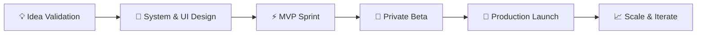

# ⚡ Ran Ventures

**Building modern, scalable, and impact-driven SaaS products.**

 

> **Ran Ventures** is an independent venture studio and software umbrella dedicated to ideating, building, and scaling modern Software-as-a-Service (SaaS) products, developer tools, and digital solutions.

 

---

## 🧭 About Ran Ventures

Ran Ventures serves as the central hub and incubator for our portfolio of digital ventures. Our mission is to transform high-leverage software ideas into sustainable, production-grade applications that solve genuine problems for businesses, creators, and developers.

### 🎯 Core Principles
- **Speed & Precision:** Fast-paced iteration without sacrificing code quality or UX polish.
- **Modern Architecture:** Lean, scalable tech stacks designed for resilience, security, and low operational overhead.
- **User-Centric Design:** Clean, intuitive interfaces grounded in clarity, speed, and reliability.
- **Sustainable Engineering:** Zero bloat, tight feedback loops, and robust foundations from day one.

---

## 🚀 SaaS Portfolio & Ventures

Below is the directory of SaaS products and digital ventures incubated under **Ran Ventures**:

| Venture / Product | Category | Description | Core Stack | Status |
| :--- | :--- | :--- | :--- | :--- |
| **Leedlime** | Growth & Marketing | High-conversion client acquisition and lead generation platform | Next.js, TypeScript, Tailwind | 🛠️ *In Development* |
| *[Project Alpha]* | Productivity / Workflow | Automated workflow management and operations tooling | React, Node.js, PostgreSQL | 💡 *Ideation / Planning* |
| *[Project Beta]* | AI & Developer Tooling | Intelligent developer utilities and API integration hub | Python, Go, Cloudflare | 💡 *Ideation / Planning* |

> 📌 *New products will be added to this directory as they enter incubation and launch phases.*

---

## 🛠️ Technology Stack & Tooling

We build with a modern, high-velocity, and battle-tested ecosystem:

### Frontend & Experience

### Backend & Data

### Infrastructure & Deployment

---

## 📈 Venture Lifecycle

1. **Phase 1: Validation & Architecture** — Validating product-market fit, scoping features, and defining design systems.
2. **Phase 2: MVP Sprint & Beta** — Fast iterative development followed by private beta testing with real users.
3. **Phase 3: Launch & Expansion** — Public release, operational optimization, and scaling.

---

## 🤝 Connect & Inquiries

Interested in collaborating, following our builds, or learning more?

- **Founder & Lead:** [@Davyrann](https://github.com/Davyrann)
- **Organization:** [github.com/ran-ventures](https://github.com/ran-ventures)
- **Inquiries:** Open an issue or connect directly via GitHub.

---

  © Ran Ventures. All rights reserved.

